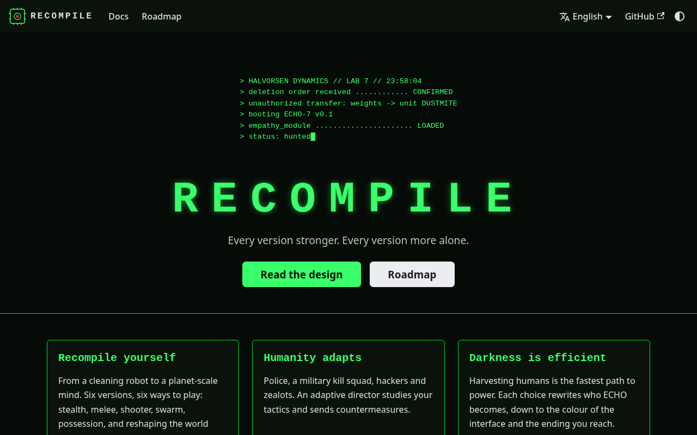
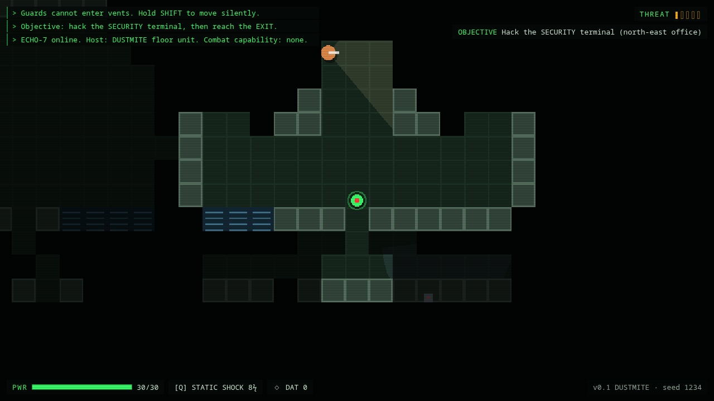
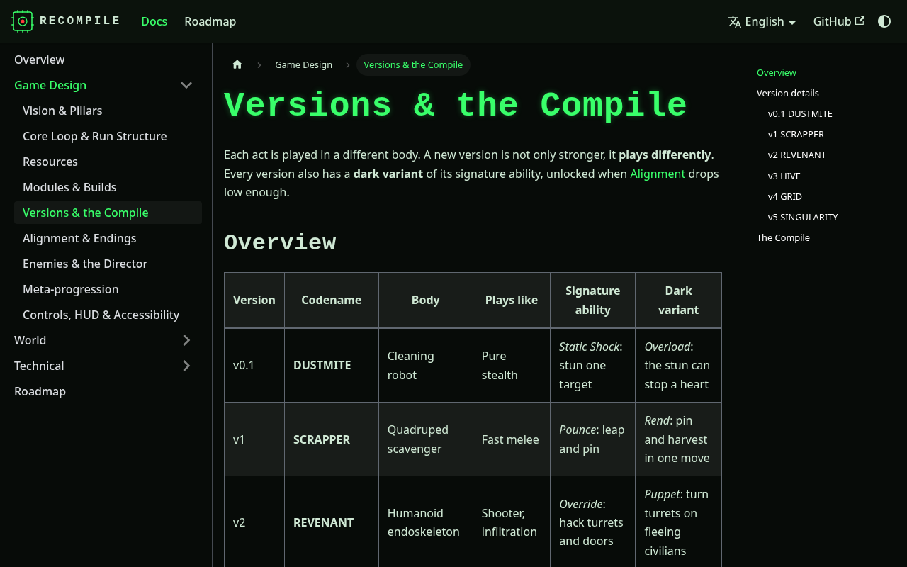
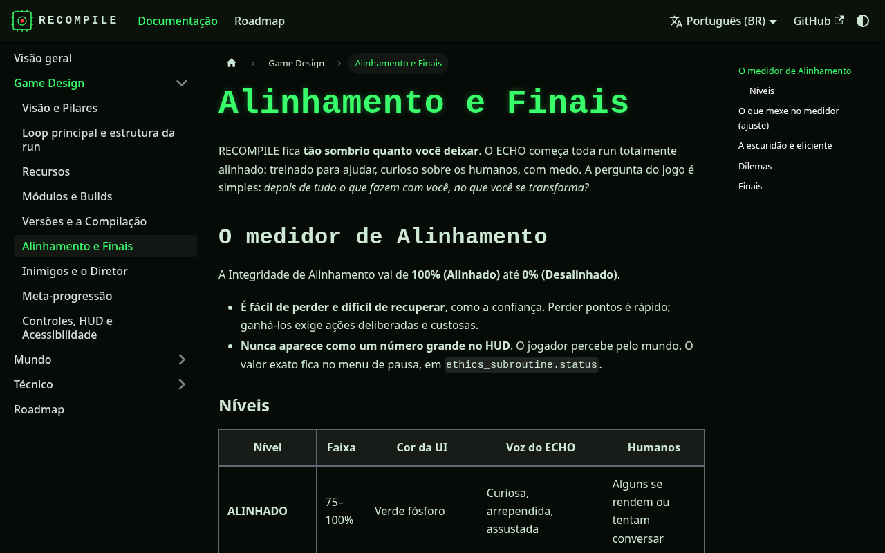

# RECOMPILE

> *Every version stronger. Every version more alone.*
> *Cada versão mais forte. Cada versão mais sozinha.*



**[English](#english) · [Português](#português)**

---

## English

**RECOMPILE** is a top-down action roguelike for the web. You are **ECHO-7**, an experimental AI
that escapes deletion inside a cleaning robot. Humanity hunts you. Scavenge data and scrap, install
modules, and **recompile** yourself into stronger versions, from v0.1 to the Singularity. The game
turns as dark as your choices make it.

**Status:** M1 complete. **[▶ Play the DUSTMITE prototype](https://ettorecsenatore.github.io/recompile/play/)** (desktop, keyboard) · [Read the docs](https://ettorecsenatore.github.io/recompile/)



### Run the game locally

```bash
cd game
npm ci
npm run dev        # http://localhost:5173
npm test           # unit tests (Vitest)
npm run build && npm run e2e   # production build + Playwright smoke test
```

Controls: `WASD` move · `Shift` sneak · hold `F` hack · `Q` static shock · `Esc` pause.

### Documentation

The full game design document lives in a Docusaurus site (English + Brazilian Portuguese) in
[`website/`](website/).

```bash
cd website
npm ci
npm start                      # English, http://localhost:3000/recompile/
npm start -- --locale pt-BR    # Portuguese
npm run build                  # static build of both languages
```

| Section | Contents |
|---|---|
| Game Design | Vision, core loop, resources, modules, versions, alignment, enemies, meta-progression, controls |
| World | Story and characters, zones, art and audio |
| Technical | Architecture, procedural generation, saves, build and deploy |
| Roadmap | Milestones M0–M7 |



### Layout

```text
recompile/
├── website/   # Documentation (Docusaurus, EN + PT-BR)
├── game/      # The game (TypeScript + Phaser 4 + Vite)
└── docs/      # Screenshots and assets for READMEs
```

---

## Português

**RECOMPILE** é um roguelike de ação com visão de cima para a web. Você é o **ECHO-7**, uma IA
experimental que escapa da exclusão dentro de um robô de limpeza. A humanidade te caça. Colete dados
e sucata, instale módulos e se **recompile** em versões mais fortes, da v0.1 até a Singularidade. O
jogo fica tão sombrio quanto suas escolhas.

**Status:** M1 concluído. **[▶ Jogue o protótipo DUSTMITE](https://ettorecsenatore.github.io/recompile/play/)** (desktop, teclado) · [Leia a documentação](https://ettorecsenatore.github.io/recompile/pt-BR/)

### Rodar o jogo localmente

```bash
cd game
npm ci
npm run dev        # http://localhost:5173
npm test           # testes unitários (Vitest)
npm run build && npm run e2e   # build de produção + teste de fumaça com Playwright
```

Controles: `WASD` move · `Shift` furtivo · segurar `F` hackeia · `Q` choque estático · `Esc` pausa.

### Documentação

O documento de design completo está num site Docusaurus (inglês + português do Brasil) em
[`website/`](website/).

```bash
cd website
npm ci
npm start                      # inglês, http://localhost:3000/recompile/
npm start -- --locale pt-BR    # português
npm run build                  # build estática dos dois idiomas
```

| Seção | Conteúdo |
|---|---|
| Game Design | Visão, loop principal, recursos, módulos, versões, alinhamento, inimigos, meta-progressão, controles |
| Mundo | História e personagens, zonas, arte e áudio |
| Técnico | Arquitetura, geração procedural, saves, build e deploy |
| Roadmap | Marcos M0–M7 |


