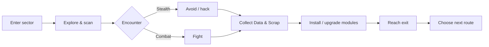
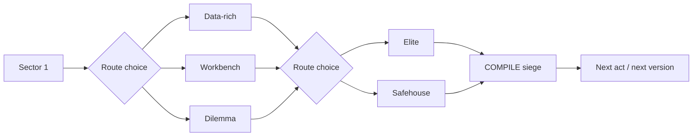

# Core Loop & Run Structure

## Moment-to-moment loop (seconds)

Move, scan, decide: **sneak, fight, hack, or run**. Every action spends or earns
[Power](./resources.md#power), and every noise raises the [Threat level](./enemies.md#threat-level).

## Sector loop (minutes)

## Act loop (one version)

Each act is played with one body (one **version**) and has this structure:

1. **3 sectors** chosen from a branching route map.
2. **1 dilemma** (a moral event) placed somewhere along the route.
3. **The Compile**: a siege at a fabricator. Survive it and you become the next version.

### Route node types

| Node | Reward | Risk |
|---|---|---|
| **Data cache** | Lots of Data | Netrunners and cameras |
| **Scrapyard** | Lots of Scrap | Heavy enemies |
| **Workbench** | Install/upgrade modules at a discount | Low |
| **Safehouse** | Restore Power, patch one Bug | None, but no loot |
| **Elite** | A rare module | A named hunter or elite squad |
| **Dilemma** | A story choice, see [Alignment](./alignment.md) | Moral cost |
| **Unknown** | Random: anything above, or an event | ? |

## Full run

| Act | Version | Zone | Target time |
|---|---|---|---|
| 0 | v0.1 DUSTMITE | Halvorsen Lab | 5 min (tutorial-weight) |
| 1 | v1 SCRAPPER | Undercity | 7 min |
| 2 | v2 REVENANT | Metropolis | 8 min |
| 3 | v3 HIVE | Outskirts | 8 min |
| 4 | v4 GRID | Fort Ironside | 8 min |
| 5 | v5 SINGULARITY | Deepcore | 8 min + ending |

**Total: ~45 minutes** for a successful run. A run can be **suspended** between sectors and
resumed later (see [Save system](../technical/save-and-deploy.md)).

## Death

If Power hits zero, ECHO **shuts down** and the run ends. You return to the **Latent Space**
hub with **Weights**, the meta-currency (see [Meta-progression](./meta-progression.md)).
