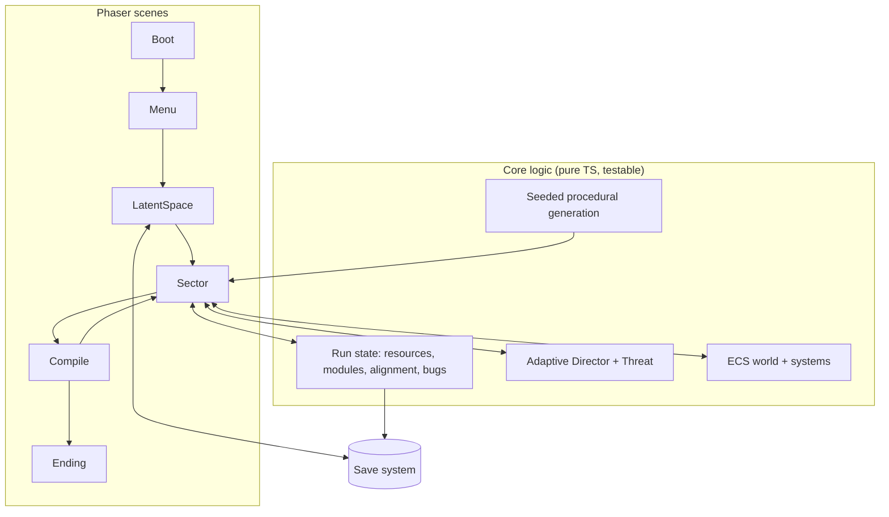

# Architecture

## Stack

| Layer | Choice | Why |
|---|---|---|
| Language | **TypeScript** (strict) | Safety on a growing codebase |
| Engine | **Phaser** | Mature 2D web engine: rendering, input, audio, tilemaps, cameras |
| Entities | Plain TypeScript entities + **systems** (`game/src/sim/systems/`) | Simple and fully testable; an ECS such as bitECS will be benchmarked for the v3 swarm in M5 |
| Bundler | **Vite** | Fast dev server, simple static builds |
| Content validation | **Zod** | Modules, enemies, bugs and dilemmas defined as data and validated at load time |
| Unit tests | **Vitest** | Game logic is pure and testable |
| E2E smoke tests | **Playwright** | Boots the game and plays a scripted sector |
| Docs | **Docusaurus** | This site, in English and Portuguese |

## Repository layout

```text
recompile/
├── game/                    # The game (Vite + Phaser)
│   ├── src/
│   │   ├── main.ts          # Boot, Phaser config
│   │   ├── scenes/          # Boot, Menu, LatentSpace, Sector, Compile, Ending
│   │   ├── ecs/
│   │   │   ├── components/  # Position, Velocity, Power, Vision, AIState…
│   │   │   └── systems/     # movement, vision, combat, noise, hacking…
│   │   ├── director/        # Threat level, adaptive countermeasures, spawn budget
│   │   ├── run/             # Run state, resources, modules, alignment
│   │   ├── procgen/         # Route map and sector generation
│   │   ├── content/         # Data: modules, enemies, bugs, dilemmas (validated with Zod)
│   │   ├── save/            # Versioned save system
│   │   └── ui/              # HUD, system log, menus
│   ├── assets/              # Sprites, tilemaps, audio
│   └── tests/
├── website/                 # Docusaurus docs (this site)
└── .github/workflows/       # CI and deploy
```

## Runtime overview



## Key principles

1. **Logic separate from rendering.** Systems operate on ECS data; Phaser only draws and reads
   input. This keeps logic unit-testable without a browser.
2. **Data-driven content.** A new module or enemy is a data entry plus, at most, one small
   behaviour function. Designers can tune numbers without touching systems.
3. **Seeded randomness.** Every run has a seed. All random rolls go through one seeded RNG
   (e.g. mulberry32 streams per subsystem) so runs are reproducible and seeds are shareable.
4. **Fixed timestep simulation** (60 Hz) with interpolated rendering, for consistent physics on
   any display.
5. **Events over coupling.** Systems communicate through a typed event bus
   (`noise:emitted`, `human:killed`, `bug:injected`), which the Director and Alignment listen to.

## Key systems

| System | Responsibility |
|---|---|
| **Vision** | Shadow-casting for ECHO's fog of war and human vision cones |
| **Noise** | Emits sound events with radius; humans investigate |
| **Human AI** | State machine: patrol → suspicious → investigate → alert → combat / flee / surrender |
| **Pathfinding** | A* on a navigation grid, with flow fields for crowds and swarms |
| **Combat** | Damage, Power drain, status effects, telegraphs |
| **Hacking** | Channelled interactions with devices, interruptible |
| **Director** | Threat level, spawn budget, adaptive countermeasures |
| **Alignment** | Listens to events, updates the meter, triggers tier changes |
| **Possession (v4)** | Transfers player control between entities |

## Performance targets

- **60 FPS** on a mid-range laptop in Chrome, Firefox and Safari.
- Up to **300 active entities** (v3 swarm plus crowds).
- Initial download **under 20 MB**, with assets per act lazy-loaded.

## Security & privacy

- Fully static, no backend, **no analytics or trackers** by default.
- Strict **Content Security Policy**; no `eval`, no inline scripts.
- Save files are **validated with a schema** before use; imported saves cannot execute code.
- Dependencies pinned with a lockfile; **Dependabot** and `npm audit` run in CI.
