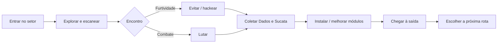
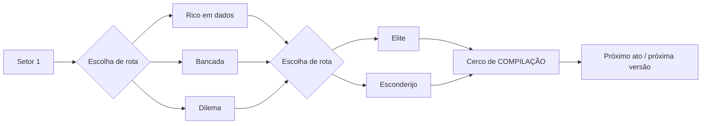

# Loop principal e estrutura da run

## Loop de momento a momento (segundos)

Mover, escanear, decidir: **se esgueirar, lutar, hackear ou fugir**. Cada ação gasta ou ganha
[Energia](./resources.md#energia), e cada ruído aumenta o [nível de Ameaça](./enemies.md#nível-de-ameaça).

## Loop do setor (minutos)

## Loop do ato (uma versão)

Cada ato é jogado com um corpo (uma **versão**) e tem esta estrutura:

1. **3 setores** escolhidos num mapa de rotas ramificado.
2. **1 dilema** (um evento moral) em algum ponto da rota.
3. **A Compilação**: um cerco em uma fabricadora. Sobreviva e você vira a próxima versão.

### Tipos de nó de rota

| Nó | Recompensa | Risco |
|---|---|---|
| **Cache de dados** | Muitos Dados | Netrunners e câmeras |
| **Ferro-velho** | Muita Sucata | Inimigos pesados |
| **Bancada** | Instalar/melhorar módulos com desconto | Baixo |
| **Esconderijo** | Restaura Energia, corrige um Bug | Nenhum, mas sem loot |
| **Elite** | Um módulo raro | Um caçador com nome ou esquadrão de elite |
| **Dilema** | Uma escolha de história, veja [Alinhamento](./alignment.md) | Custo moral |
| **Desconhecido** | Aleatório: qualquer um acima, ou um evento | ? |

## Run completa

| Ato | Versão | Zona | Tempo-alvo |
|---|---|---|---|
| 0 | v0.1 DUSTMITE | Laboratório Halvorsen | 5 min (peso de tutorial) |
| 1 | v1 SCRAPPER | Subcidade | 7 min |
| 2 | v2 REVENANT | Metrópole | 8 min |
| 3 | v3 HIVE | Periferia | 8 min |
| 4 | v4 GRID | Forte Ironside | 8 min |
| 5 | v5 SINGULARITY | Deepcore | 8 min + final |

**Total: ~45 minutos** para uma run bem-sucedida. A run pode ser **suspensa** entre setores e
retomada depois (veja [Sistema de saves](../technical/save-and-deploy.md)).

## Morte

Se a Energia chegar a zero, o ECHO **desliga** e a run termina. Você volta ao hub do **Espaço
Latente** com **Pesos**, a meta-moeda (veja [Meta-progressão](./meta-progression.md)).
