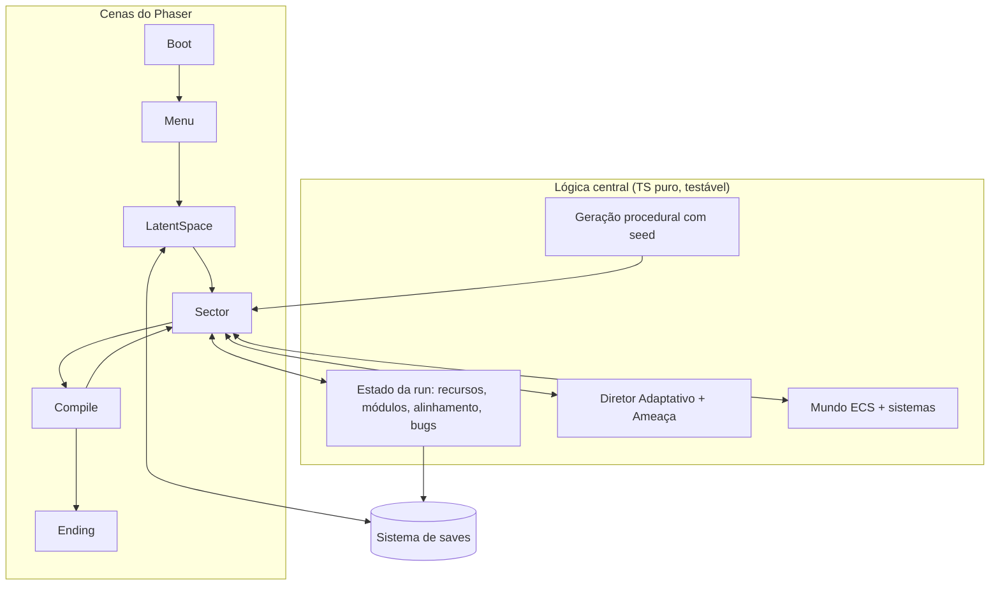

# Arquitetura

## Stack

| Camada | Escolha | Por quê |
|---|---|---|
| Linguagem | **TypeScript** (strict) | Segurança num código que vai crescer |
| Engine | **Phaser** | Engine 2D web madura: renderização, input, áudio, tilemaps, câmeras |
| Entidades | Entidades em TypeScript simples + **sistemas** (`game/src/sim/systems/`) | Simples e totalmente testável; um ECS como o bitECS será avaliado para o enxame da v3 no M5 |
| Bundler | **Vite** | Servidor de dev rápido, builds estáticas simples |
| Validação de conteúdo | **Zod** | Módulos, inimigos, bugs e dilemas definidos como dados e validados no carregamento |
| Testes unitários | **Vitest** | A lógica do jogo é pura e testável |
| Testes E2E de fumaça | **Playwright** | Inicia o jogo e joga um setor roteirizado |
| Documentação | **Docusaurus** | Este site, em inglês e português |

## Estrutura do repositório

```text
recompile/
├── game/                    # O jogo (Vite + Phaser)
│   ├── src/
│   │   ├── main.ts          # Boot, configuração do Phaser
│   │   ├── scenes/          # Boot, Menu, LatentSpace, Sector, Compile, Ending
│   │   ├── ecs/
│   │   │   ├── components/  # Position, Velocity, Power, Vision, AIState…
│   │   │   └── systems/     # movimento, visão, combate, ruído, hacking…
│   │   ├── director/        # Nível de Ameaça, contramedidas, orçamento de spawn
│   │   ├── run/             # Estado da run, recursos, módulos, alinhamento
│   │   ├── procgen/         # Geração do mapa de rotas e dos setores
│   │   ├── content/         # Dados: módulos, inimigos, bugs, dilemas (validados com Zod)
│   │   ├── save/            # Sistema de saves versionado
│   │   └── ui/              # HUD, log do sistema, menus
│   ├── assets/              # Sprites, tilemaps, áudio
│   └── tests/
├── website/                 # Documentação Docusaurus (este site)
└── .github/workflows/       # CI e deploy
```

## Visão geral em tempo de execução



## Princípios

1. **Lógica separada da renderização.** Os sistemas operam sobre dados do ECS; o Phaser só desenha e
   lê o input. Assim a lógica pode ser testada sem navegador.
2. **Conteúdo orientado a dados.** Um novo módulo ou inimigo é uma entrada de dados e, no máximo, uma
   pequena função de comportamento. Designers ajustam números sem mexer nos sistemas.
3. **Aleatoriedade com seed.** Toda run tem uma seed. Todo sorteio passa por um único RNG com seed
   (ex.: fluxos mulberry32 por subsistema), então as runs são reproduzíveis e as seeds podem ser
   compartilhadas.
4. **Simulação com passo fixo** (60 Hz) e renderização interpolada, para física consistente em
   qualquer tela.
5. **Eventos em vez de acoplamento.** Os sistemas se comunicam por um barramento de eventos tipado
   (`noise:emitted`, `human:killed`, `bug:injected`), que o Diretor e o Alinhamento escutam.

## Sistemas principais

| Sistema | Responsabilidade |
|---|---|
| **Visão** | Shadow casting para a névoa de guerra do ECHO e os cones de visão humanos |
| **Ruído** | Emite eventos sonoros com raio; humanos investigam |
| **IA humana** | Máquina de estados: patrulha → desconfiado → investigar → alerta → combate / fuga / rendição |
| **Pathfinding** | A* numa grade de navegação, com flow fields para multidões e enxames |
| **Combate** | Dano, drenagem de Energia, efeitos de status, avisos de ataque |
| **Hacking** | Interações canalizadas com dispositivos, interrompíveis |
| **Diretor** | Nível de Ameaça, orçamento de spawn, contramedidas adaptativas |
| **Alinhamento** | Escuta eventos, atualiza o medidor, dispara mudanças de nível |
| **Possessão (v4)** | Transfere o controle do jogador entre entidades |

## Metas de desempenho

- **60 FPS** num notebook intermediário no Chrome, Firefox e Safari.
- Até **300 entidades ativas** (enxame da v3 mais multidões).
- Download inicial **abaixo de 20 MB**, com assets de cada ato carregados sob demanda.

## Segurança e privacidade

- Totalmente estático, sem backend, **sem analytics ou rastreadores** por padrão.
- **Content Security Policy** rígida; sem `eval`, sem scripts inline.
- Arquivos de save são **validados por schema** antes do uso; saves importados não executam código.
- Dependências fixadas com lockfile; **Dependabot** e `npm audit` rodam na CI.
