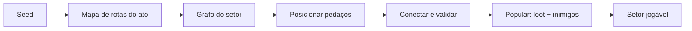

# Geração procedural

Os setores são **montados a partir de pedaços feitos à mão**, não gerados tile por tile. Isso mantém
as fases legíveis e bem desenhadas, mas ainda variando a cada run.

## Pipeline

### 1. Mapa de rotas
Para cada ato, gera um pequeno grafo ramificado (3 camadas, 2–3 nós por camada) e atribui tipos de
nó (Cache de dados, Ferro-velho, Bancada, Esconderijo, Elite, Dilema, Desconhecido) com regras de
peso. Por exemplo: pelo menos uma Bancada por ato e nunca duas Elites seguidas.

### 2. Grafo do setor
Um grafo abstrato de **salas**: entrada, saída, 2–4 pontos de interesse, salas opcionais. O grafo
garante pelo menos **dois caminhos distintos** da entrada até a saída (furtivo e barulhento).

### 3. Posicionamento dos pedaços
Cada zona tem uma biblioteca de **pedaços** feitos no Tiled (por exemplo, 16×16 tiles), marcados
com suas conexões de porta (N/L/S/O), sua função (arena de combate, corredor furtivo, cofre) e sua
dificuldade. O gerador posiciona pedaços cujas conexões combinam com o grafo.

### 4. Conectar e validar
- Corredores e dutos ligam os pedaços.
- Um flood fill confere se a saída e todos os pontos de interesse são alcançáveis.
- Os dutos formam uma **segunda camada de navegação**, usada pelas versões pequenas (v0.1, drones
  da v3).
- Se a validação falhar, gera de novo com a próxima sub-seed (número limitado de tentativas).

### 5. Popular
O [Diretor](../design/enemies.md#o-diretor-adaptativo) recebe um **orçamento de spawn** baseado no
ato, na profundidade do setor, no tipo de nó e na Época. Ele compra grupos de inimigos do conjunto
da zona, aplicando as contramedidas ativas. O loot usa um orçamento separado, para que salas
arriscadas tenham recompensas melhores.

## Determinismo

- Uma seed mestre por run; cada subsistema (rota, layout, loot, spawns) recebe seu próprio fluxo
  derivado, então mudar as regras de loot não muda os layouts.
- As seeds podem ser exibidas e digitadas num modo **Run com Seed**.

## Testando a geração

- Um script headless gera **milhares de setores por zona** na CI e confere alcance, número de
  caminhos e limites de orçamento.
- Seeds que falham são guardadas como casos de regressão.
